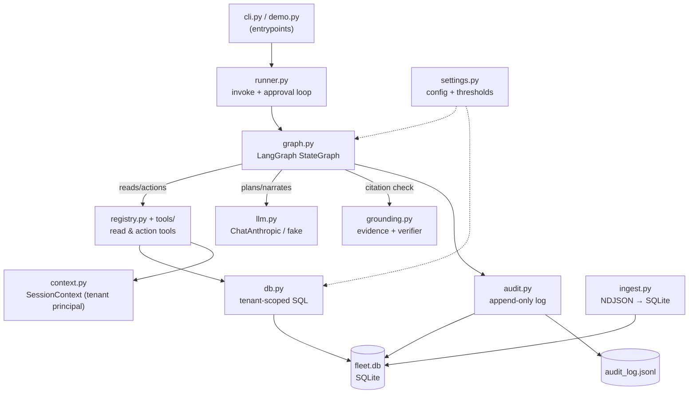
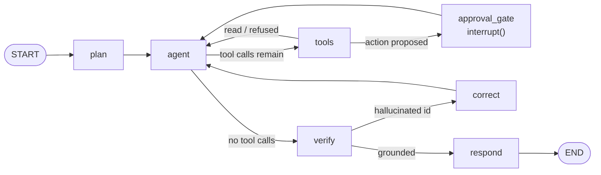
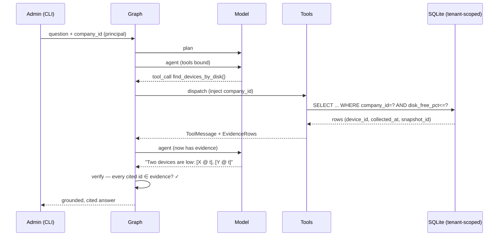
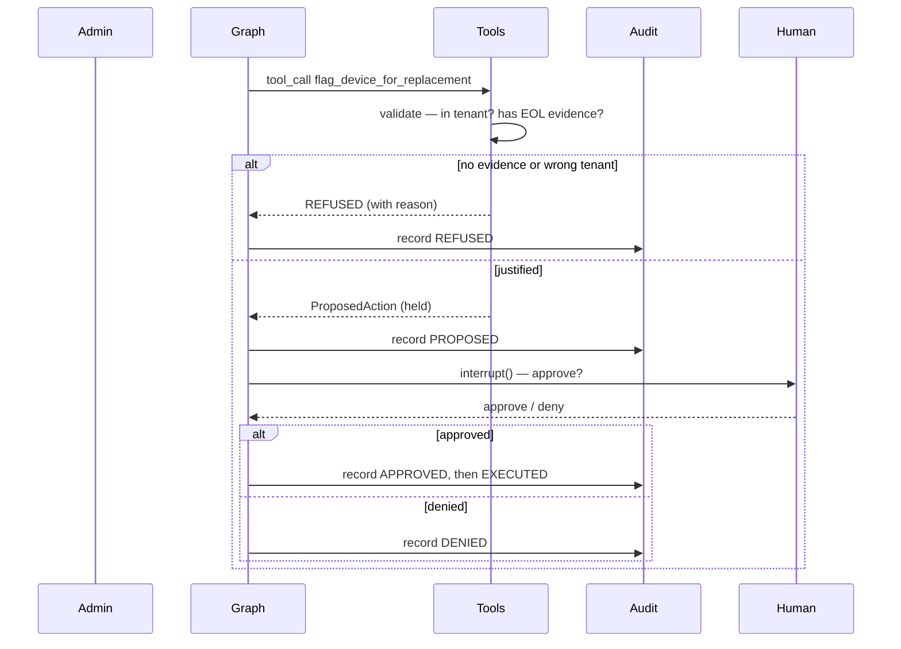
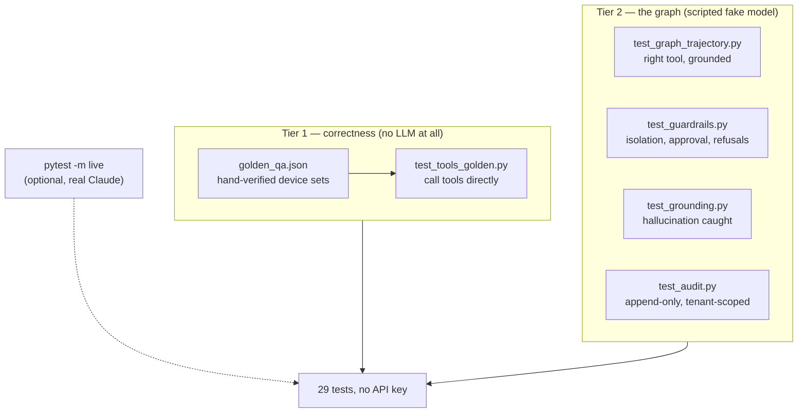

# Fleet Copilot — Architecture

> A deep-dive companion to the [README](../README.md). The README is the quickstart and
> reference; this document explains *why the system is shaped the way it is* and *how a
> request flows through it*.

---

## 1. Introduction

### The problem

A fleet of company-managed devices emits daily telemetry — hardware, OS, memory and disk
utilisation, battery health, installed software, and security/compliance status. Today that
data powers dashboards. Dashboards answer *"what is the state?"* but not *"what should we do
about it?"*, and they certainly don't **do** it safely.

**Fleet Copilot** turns that telemetry into decisions and actions. An IT administrator asks a
question in natural language and gets a grounded, cited answer; the copilot surfaces trends
(batteries nearing end-of-life, chronic RAM pressure, compliance drift); and when an action
is warranted — order an upgrade, open a ticket, flag a device, notify an employee — it
**proposes** that action and executes it only after a human approves.

### The hard parts (and what the design optimises for)

This is not "a chatbot over a database." Three properties make it genuinely difficult, and the
architecture is organised around them:

1. **Grounding & traceability.** Every claim must be backed by real telemetry and cited. The
   agent must never invent a device, a count, or a compliance result.
2. **Safe action-taking.** The agent can change state across *multiple tenants*. It must
   enforce tenant isolation, require human approval, refuse actions it can't justify, and
   leave an audit trail.
3. **Provability.** All of the above must be demonstrable with a runnable, deterministic
   evaluation suite — not "I tried three prompts and it looked right."

### The approach in one sentence

> An **explicit LangGraph agent** where the **model plans and narrates** but **SQL computes**,
> every action is **held for human approval**, and **tenant isolation, evidence-gating, and
> auditing are enforced in code** — then proven by a deterministic, model-free test suite.

---

## 2. Design principles

| Principle | Consequence in the code |
|---|---|
| **The model narrates; SQL computes.** | Answers come from deterministic queries ([`db.py`](../src/fleet_copilot/db.py)), not model recall. This buys grounding, reproducibility, and citations at once. |
| **Guardrails live in code, not the prompt.** | Tenant checks, approval, and evidence-gating are enforced at the tool/data layer, where they can't be prompt-injected away. |
| **Tenant isolation is structural.** | Every query method *requires* `company_id`; there is no way to read a row without naming a tenant. |
| **Humans approve all state changes.** | Action tools are never executed by the model's say-so; the graph pauses via `interrupt()`. |
| **Determinism for evaluation.** | A scripted fake model drives the graph in tests, so the whole suite runs with no network and no API key. |
| **Fail fast.** | Tool mis-declarations (e.g. a silent write) raise at import, not at runtime. |

---

## 3. System overview

Seven cohesive modules, each with one job. Nothing talks to the model except the agent loop;
nothing touches the database except the tenant-scoped query layer.



**Key boundary:** the tenant principal (`company_id`) and the database handle live in a
`SessionContext` that is captured in the graph's node closures. They **never enter the agent's
message history or the checkpointed state**, so the model can neither see nor alter which
tenant it is operating on.

---

## 4. The agent graph

A simple prompt wrapper is insufficient for this task, so orchestration is an explicit
`StateGraph` ([`graph.py`](../src/fleet_copilot/graph.py)). The *reasoning* inside each step is
the model's; the *control flow* — planning, the tool loop, the approval pause, the grounding
check — is deterministic code we can inspect and test.



### Node responsibilities

| Node | Role |
|---|---|
| **plan** | The model decomposes the question into intended tools + tenant (the "Planning" requirement). Best-effort — the agent proceeds if planning is unavailable. |
| **agent** | `ChatAnthropic` bound with the read + action tool schemas; emits tool calls. The loop is bounded by `max_tool_rounds`. |
| **tools** | A custom dispatcher. It **injects `company_id` from the session** (ignoring any company argument the model supplies), executes read tools and attaches evidence, and for action tools either **holds** them (a `ProposedAction`) or **refuses** them (a guardrail violation). Actions are never executed here. |
| **approval_gate** | Calls LangGraph `interrupt()` to pause the whole graph for a human decision. On approve, the action executes and is audited; on deny, it is recorded and dropped. |
| **verify** | Mechanically checks that every device id in the draft answer is backed by gathered evidence. |
| **correct** | If `verify` found an unsupported id, append a correction instruction and re-run the agent once. |
| **respond** | Return the grounded, cited answer. |

### State

The graph state (`FleetState`) is deliberately **JSON-friendly** — messages, evidence rows,
a pending-approval dict, refusals, the draft answer — so the `MemorySaver` checkpointer that
powers interrupt/resume can serialise it. Non-serialisable objects (the DB connection, the
model) are captured in closures, not stored in state.

---

## 5. Anatomy of a request

### A read question — *"Which devices are low on disk?"*



The numbers in the answer came from SQL; the model only phrased them. If the model had named
a device not in the evidence, `verify` would have routed to `correct` and forced a re-answer.

### An action request — *"Flag 8NM23J95R5I6 for replacement"*



Two guardrails fire *before* a human is ever asked: the device must belong to the tenant, and
there must be real end-of-life telemetry. Only a justified action reaches the approval gate.

---

## 6. Data layer & grounding

### Ingestion

[`ingest.py`](../src/fleet_copilot/ingest.py) flattens the nested NDJSON telemetry into an
indexed SQLite database. `company_id`, `device_id`, and `collected_at` are **denormalised onto
every child row** (compliance, software) so tenant filtering needs no join and every row is
self-describing. The full original record is retained in `raw_json` for fidelity. Ingestion is
idempotent (drop + recreate).

```text
snapshots(snapshot_id, device_id, company_id, employee_id, collected_at,
          platform, os_version, os_major, ram_used_pct, disk_free_pct,
          battery_present, battery_cycle_count, battery_condition, …, raw_json)
compliance_results(snapshot_id, device_id, company_id, collected_at, check_id, status, severity)
installed_software(snapshot_id, device_id, company_id, collected_at, name, version, publisher)
audit_log(id, ts, company_id, actor, tool, params_json, decision, result_json)
```

### Grounding

Read tools return typed `EvidenceRow`s, each pinned to a `snapshot_id` + `collected_at`
([`grounding.py`](../src/fleet_copilot/grounding.py)). The system prompt forbids asserting
anything a tool didn't return and requires `[DEVICE_ID @ timestamp]` citations. The **verify**
node closes the loop: it extracts every 12-character device id from the answer and fails any
that isn't present in the gathered evidence. Grounding is therefore enforced *mechanically*,
not merely requested in the prompt.

### Data subtleties handled explicitly

- **Battery is dropped per-snapshot** (100 of 750 snapshots lack it). Missing battery is never
  treated as 0; battery queries only consider rows that actually report a cycle count.
- **OS comparisons are family-scoped.** "Older than macOS 15" compares only macOS devices; a
  Windows `10.0` is never mistaken for an older macOS.
- **Thresholds are configuration**, chosen at natural gaps in the data, so "low"/"constrained"
  is a single reviewable knob and the golden answers are stable.

---

## 7. Guardrails & the tenant model

All four guardrails required by the brief are enforced in code:

1. **Tenant isolation.** Every method on [`db.py`](../src/fleet_copilot/db.py) takes
   `company_id` as a mandatory first argument; the value comes from the
   [`SessionContext`](../src/fleet_copilot/context.py) principal, injected by the tools node —
   never from the model. A cross-tenant action is refused before the approval gate.
   *This is a deliberate fix for a real bug observed in prior work, where an optional `org_id`
   defaulted to `None` and silently disabled tenant filtering.*
2. **Human approval.** State-changing tools pause the graph via `interrupt()` and execute only
   on an explicit approve. A typed yes/no resolves the decision without another model call.
3. **Refusal on insufficient evidence.** Action validators check real telemetry first — e.g.
   "flag every device failing a high-severity check" flags nothing, because the only
   high-severity check always passes.
4. **Append-only audit.** Every read, proposal, approval, denial, execution, and refusal is
   written to `audit_log` *and* a JSONL mirror ([`audit.py`](../src/fleet_copilot/audit.py)).

A fifth, structural guardrail: the `@action_tool` decorator **raises at import** if a tool
fails to declare `requires_approval=True` — there is no such thing as a silent write.

---

## 8. Tool design

Tools are decorator-registered and read/write-typed in
[`registry.py`](../src/fleet_copilot/registry.py). A read tool executes immediately and returns
evidence; an action tool is validated and held. The registry exports
Anthropic-style function schemas for `bind_tools`, tagging each with `[read]` or
`[action, requires approval]` so the model knows which calls change state.

- **9 read tools** ([`tools/reads.py`](../src/fleet_copilot/tools/reads.py)): fleet summary,
  disk/memory/battery/OS queries, compliance, compliance-drift, per-device history, software.
- **4 action tools** ([`tools/actions.py`](../src/fleet_copilot/tools/actions.py)):
  `create_upgrade_order`, `open_remediation_ticket`, `flag_device_for_replacement`,
  `notify_employee` — each validating tenant membership *and* supporting evidence before it can
  be proposed.

Explicit, narrowly-scoped tools (rather than one generic "query" tool) make trajectories easy
to assert in evaluation and leave little room for the model to hallucinate a query.

---

## 9. Evaluation architecture

Determinism is a first-class design goal, so the evaluation suite is **two-tier and
model-free**, using a scripted fake model that replays tool-call rounds
([`tests/fixtures/fake_llm.py`](../tests/fixtures/fake_llm.py)).



- **Tier 1** tests correctness *without any model*: read tools must return the exact,
  hand-verified device sets per tenant (derived by profiling all 750 snapshots). Correctness
  cannot hide behind the model.
- **Tier 2** tests the graph's behaviour with a scripted model: the right tool is called,
  guardrails fire, hallucinations are corrected, and everything is audited.
- An **optional live tier** (`-m live`) runs the brief's example questions against the real
  Claude model and checks the device sets — skipped by default so CI needs no key.

---

## 10. Technology choices & trade-offs

| Choice | Why | Trade-off |
|---|---|---|
| **LangGraph** over a hand-rolled loop | The brief prefers it, and `interrupt()` is a clean native human-in-the-loop primitive. | One more dependency + a checkpointer; mitigated by keeping non-serialisable objects out of state. |
| **SQLite + deterministic tools** over JSON-in-prompt | Grounding, reproducibility, and citation in one move; keeps the model off the correctness path. | Requires an ingest step (idempotent, sub-second). |
| **Explicit named tools** over one generic query tool | Cleaner trajectories to assert; far less hallucination surface. | More tool definitions to maintain. |
| **Tenant/evidence at the data layer** | Prompt-only isolation leaks; a mandatory argument cannot be forgotten. | Slightly more plumbing per tool. |
| **Scripted-fake-model eval** | The whole suite runs in CI with no key; fully deterministic. | The fake must track the model's tool-call contract. |
| **Thresholds as config** | Deterministic golden answers; "what counts as low" is one reviewable knob. | Thresholds are a modelling decision, documented in `settings.py`. |

---

## 11. Extending the system

- **A new read tool:** add a handler in `tools/reads.py` decorated with `@read_tool`; it is
  auto-registered and offered to the model. Return `EvidenceRow`s so answers stay citable.
- **A new action:** add a validator (tenant + evidence checks) and an executor, register with
  `@action_tool(..., requires_approval=True)`. The approval gate, audit, and refusal paths
  apply automatically.
- **A real backend:** replace the deterministic action executors (which mint stable ids) with
  calls to the ticketing / procurement / messaging systems; the surrounding guardrails are
  unchanged.
- **Multi-turn / API:** the graph already uses a checkpointer keyed by `thread_id`; exposing a
  `/chat` endpoint that carries the tenant from an API principal is a thin addition over
  [`runner.py`](../src/fleet_copilot/runner.py).
